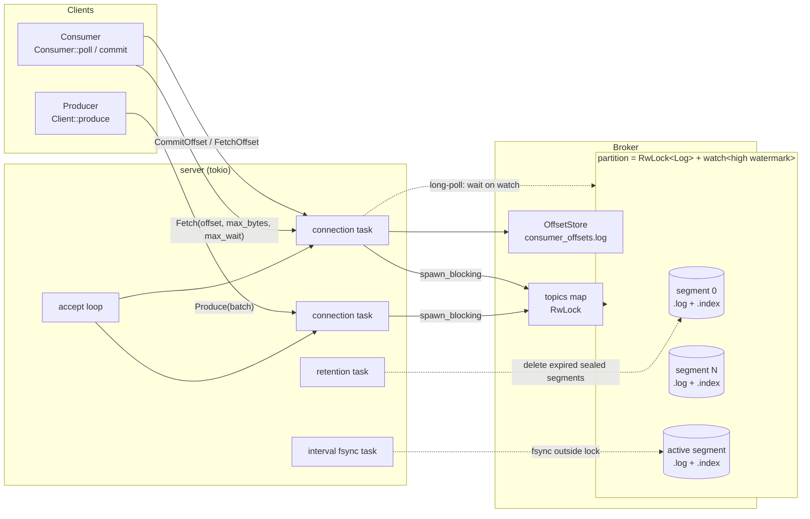

# ledgerlog

**A durable, segmented, append-only commit log — a small Kafka written from scratch in Rust.**

ledgerlog stores ordered streams of records in topics and partitions, serves
them over a compact binary TCP protocol, tracks consumer-group offsets, and
recovers cleanly from crashes by validating CRCs and truncating torn writes.
It is a single-node broker in about 4k lines of Rust, built to show how a commit log
works under the hood: segment files, sparse indexes, fsync policies,
retention, long-polling, and crash recovery.

```text
$ ledgerlog serve --data-dir ./data --fsync 100ms &
$ seq 1 5 | ledgerlog produce --topic numbers
produced 5 message(s)
$ ledgerlog consume --topic numbers --group demo -n 3
0	-	1
1	-	2
2	-	3
consumed 3 message(s); group demo committed offset 3
$ ledgerlog consume --topic numbers --group demo      # resumes at offset 3
3	-	4
4	-	5
consumed 2 message(s); group demo committed offset 5
```

## Features

- **Segmented storage**: topics → partitions → segment files that roll by size
  (`--segment-bytes`) or age (`--segment-ms`).
- **Self-describing frames**: every record is `[len][crc32][offset][timestamp][key][value]`,
  identical on disk and on the wire, so a fetch ships raw segment bytes and the
  client re-verifies every CRC.
- **Sparse offset index** per segment (one entry per 4 KiB of log by default):
  a seek is a binary search plus a short forward scan.
- **Crash recovery**: on startup the active segment is re-read frame by frame,
  CRC- and offset-checked, and truncated at the first torn or corrupt frame.
  The index is rebuilt to match.
- **Configurable durability**: `fsync` on every write, every N ms (off the
  write path), or never.
- **Retention** by age and by size, one whole sealed segment at a time.
- **Network server** on tokio with batched Produce, Fetch with `max_bytes`
  and **long-poll** (`max_wait_ms`), CommitOffset / FetchOffset for consumer
  groups (persisted, fsynced, compacted), CreateTopic, and Metadata.
- **Async client library** with a `Consumer` that resumes from its group's
  committed offset.
- **CLI**: `serve`, `create-topic`, `topics`, `produce`, `consume`, `bench`.

## Architecture



**Write path.** A produce request carries a batch of `(key, value)` pairs. The
partition's write lock is taken, the batch is encoded into one contiguous
buffer of frames (offsets and a broker timestamp assigned), appended with a
single `write`, sparse index entries are appended for every
`index_interval_bytes` crossed, and the new high watermark is published on
the partition's `watch` channel. Depending on the fsync policy the segment is
synced before the response is sent.

**Read path.** A fetch takes the partition's read lock, picks the segment with
the greatest base offset ≤ the requested offset (`BTreeMap::range`), binary
searches that segment's index, walks frame headers forward to the exact
offset, then reads up to `max_bytes` with a positional read and trims to the
last whole frame. It always returns at least one frame, so a record larger
than `max_bytes` cannot stall a consumer. If nothing is available, the handler
subscribes to the high-watermark channel *before* re-checking (no lost
wake-ups) and waits until data arrives or `max_wait_ms` elapses.

**Concurrency.** Each partition has its own `RwLock`, so partitions never
contend and readers only block writers for the duration of a `pread`. Storage
calls are synchronous and run on tokio's blocking pool.

### Source layout

| Module | Responsibility |
|--------|----------------|
| `record.rs` | Frame encode/decode, CRC32, header peeking |
| `segment.rs` | One `.log` + `.index` pair: append, indexed lookup, read, recovery |
| `log.rs` | A partition: segment set, rolling, fsync policy, retention |
| `offsets.rs` | Durable consumer-group offsets with compaction |
| `broker.rs` | Topics → partitions, high-watermark channels, metadata |
| `protocol.rs` | Wire format for requests/responses, frame I/O |
| `server.rs` | tokio accept loop, dispatch, long-poll, background tasks |
| `client.rs` | Async `Client` and single-partition `Consumer` |
| `main.rs`, `bench.rs` | CLI and benchmark harness |

## On-disk format

```text
<data_dir>/
├── consumer_offsets.log                 # group commits (CRC frames)
└── topics/
    └── orders/
        ├── 0/
        │   ├── 00000000000000000000.log     # sealed segment
        │   ├── 00000000000000000000.index
        │   ├── 00000000000000052113.log     # active segment (base offset 52113)
        │   └── 00000000000000052113.index
        └── 1/ ...
```

Segment files are named after their base offset, zero-padded to 20 digits so
lexicographic order equals offset order.

### Record frame (`.log` files and Fetch responses)

All integers are big-endian.

| Field | Type | Bytes | Notes |
|-------|------|------:|-------|
| `len` | u32 | 4 | Length of everything after this field |
| `crc` | u32 | 4 | CRC-32 (IEEE) of every byte after this field |
| `offset` | u64 | 8 | Absolute offset in the partition |
| `timestamp` | i64 | 8 | Milliseconds since the Unix epoch, assigned by the broker on append |
| `key_len` | i32 | 4 | `-1` = null key, `0` = empty key |
| `key` | bytes | `key_len` | |
| `value_len` | u32 | 4 | |
| `value` | bytes | `value_len` | |

Fixed overhead is **32 bytes per record**. Decoding rejects a `len` below the
minimum or above `max_record_bytes` (default 8 MiB), so garbage cannot trigger
huge allocations, and checks that `key_len` and `value_len` add up to `len`.
The offset is stored in the frame even though it could be derived from the
position. That costs 8 bytes per record and buys three things: a fetch can
return raw segment bytes, recovery can detect frames that are out of
sequence, and a sealed segment's end can be found by walking headers only.

### Sparse index entry (`.index` files)

| Field | Type | Bytes | Notes |
|-------|------|------:|-------|
| `relative_offset` | u32 | 4 | `offset - segment_base_offset` |
| `position` | u32 | 4 | Byte position of that frame in the `.log` |

An entry is appended each time at least `index_interval_bytes` (default 4096)
of log data were written since the previous entry. Positions are u32, so
segments are capped at 2 GiB. The index is loaded into memory when a segment
is opened (8 bytes per ~4 KiB of log, about 2 MiB of RAM per GiB of data). A
sealed segment's index is trusted only if it is well formed: a multiple of
8 bytes, strictly increasing, with every position inside the file. Otherwise
it is rebuilt from the log.

### Consumer offsets (`consumer_offsets.log`)

The same record frame, with `key = "<group>\0<topic>\0<partition>"` and
`value = committed offset (u64)`. The committed offset is the *next* offset
the group should read. On startup the file is replayed, last write wins, and
it stops at the first bad frame, which is then truncated. Once the file holds
more than 4× as many frames as live keys (and over 1024 frames), it is
rewritten as a snapshot: write to a temp file, fsync, rename, fsync the
directory.

## Wire protocol

```text
request  := size:u32 | api:u8 | correlation_id:u32 | body
response := size:u32 | correlation_id:u32 | status:u8 | body
string   := len:u16 | utf8        bytes := len:u32 | raw        nullable_bytes := len:i32 (-1 = null) | raw
```

| api | Request body | Response body |
|----:|--------------|---------------|
| 0 Produce | `topic:string, partition:u32, count:u32, count × (key:nullable_bytes, value:bytes)` | `base_offset:u64, last_offset:u64` |
| 1 Fetch | `topic:string, partition:u32, offset:u64, max_bytes:u32, max_wait_ms:u32` | `start_offset:u64, high_watermark:u64, records:bytes` (raw frames) |
| 2 CommitOffset | `group:string, topic:string, partition:u32, offset:u64` | — |
| 3 FetchOffset | `group:string, topic:string, partition:u32` | `offset:i64` (`-1` = none) |
| 4 CreateTopic | `topic:string, partitions:u32` | — |
| 5 Metadata | `topic:string` (empty = all) | per topic: name and, per partition, `start, end, size_bytes, segments` |

Non-zero statuses: `1` internal, `2` offset out of range (carries
`requested, start, end`), `3` unknown topic/partition, `4` topic exists,
`5` invalid request, `6` record too large, `7` corrupt. A malformed frame gets
an error reply and then the connection is closed, because the stream position
can no longer be trusted. Other connections are unaffected. Frames are
capped at 64 MiB.

## Durability guarantees and trade-offs

| `--fsync` | When a produce is acknowledged | Survives process crash (`kill -9`) | Survives OS crash / power loss |
|-----------|--------------------------------|:---:|:---:|
| `always` | after `write` **and** `fsync` of the active segment | ✅ | ✅ every acknowledged record |
| `<n>ms` (default `100ms`) | after `write`; a background task fsyncs dirty partitions every *n* ms **outside** the partition lock | ✅ | up to ~*n* ms of acknowledged writes may be lost |
| `never` | after `write` | ✅ | whatever the OS had not flushed is lost |

A `write` that returned has reached the kernel page cache, so a process
crash never loses acknowledged data under any policy. What the policies
change is exposure to OS crashes and power loss.

**Recovery procedure** (runs on every start, not only after a crash):

1. List `*.log` files per partition and sort them by base offset.
2. **Sealed segments**: load the index. If it is well formed, walk frame
   headers from the last index entry to EOF to find the next offset and the
   newest timestamp. If the headers disagree with the index, fall back to a
   full scan.
3. **Active segment**: full scan. Read each frame, check the length bounds,
   the CRC and that `offset == expected`. Stop at the first failure,
   `ftruncate` the file there, fsync it, and rewrite the index from the scan.
4. Check that segments are contiguous: each one's next offset must equal the
   following segment's base offset.

A truncated record's offset is reused by the next append. Because the record
was never fully written, it could not have been acknowledged under
`fsync=always`, so no acknowledged offset is ever reused under that policy.

Other guarantees and deliberate trade-offs:

- **Ordering and atomicity**: offsets are dense and strictly increasing per
  partition. A produce batch is appended with one `write` under the partition
  lock, so batches never interleave. The integration tests check this with 8
  concurrent producers.
- **End-to-end integrity**: the server sends raw frames and the client
  re-verifies every CRC, so corruption of sealed data on disk is detected by
  readers. It is not detected proactively, because only the active segment is
  re-scanned at startup.
- **Consumer groups give at-least-once delivery**: a group commits the next
  offset to read after processing, and commits are fsynced before the reply
  unless `--fsync never`. There is no group membership or rebalancing. A
  "group" is a named, durable cursor per partition.
- **`fsync=always` serializes on the partition lock**: each batch pays one
  fsync, with no group commit. On macOS, Rust's `sync_data` issues
  `F_FULLFSYNC`, which flushes the drive cache and costs milliseconds. See
  the benchmarks.
- **Retention is per segment**: a segment is deleted only when it is sealed
  and its *newest* record is older than `retention_ms`, or while the
  partition exceeds `retention_bytes`. The active segment is never deleted, so
  combine retention with `--segment-ms` on low-traffic topics. A consumer that
  falls behind retention gets `OffsetOutOfRange` and `Consumer` resets it to
  the earliest offset.
- **Timestamps are log-append time** (broker clock), so time-based retention
  does not depend on producer clocks.
- **Single node**: there is no replication. A lost disk loses the data. See
  the roadmap.

## Usage

```bash
cargo build --release
BIN=./target/release/ledgerlog

# Broker: 64 MiB segments, 1 h retention, fsync every 50 ms
$BIN serve --addr 127.0.0.1:9092 --data-dir ./data \
     --segment-bytes 67108864 --retention-ms 3600000 --fsync 50ms

$BIN create-topic --topic orders --partitions 3
$BIN produce --topic orders --partition 1 --key user-42 -m '{"id":1}' -m '{"id":2}'
cat events.jsonl | $BIN produce --topic orders --batch-size 1000   # stdin, batched

$BIN consume --topic orders --partition 1 --from earliest          # exits when caught up
$BIN consume --topic orders --group billing --from latest --follow # long-polls forever
$BIN topics                                                        # offsets, sizes, segments
```

`serve` flags: `--segment-bytes`, `--segment-ms`, `--retention-ms` (0 disables),
`--retention-bytes`, `--fsync always|never|<n>ms`, `--default-partitions` (for
topics auto-created by produce), `--index-interval-bytes`,
`--retention-check-secs`. Logging is set with `RUST_LOG`.

### As a library

```rust
use ledgerlog::{Client, Consumer, StartFrom};
use std::time::Duration;

#[tokio::main]
async fn main() -> ledgerlog::Result<()> {
    let mut producer = Client::connect("127.0.0.1:9092").await?;
    let batch = vec![(Some("user-1"), "signed up"), (Some("user-2"), "logged in")];
    let (first, last) = producer.produce("events", 0, &batch).await?;
    println!("appended offsets {first}..={last}");

    let client = Client::connect("127.0.0.1:9092").await?;
    let mut consumer =
        Consumer::new(client, Some("analytics"), "events", 0, StartFrom::Earliest).await?;
    consumer.max_wait = Duration::from_secs(1); // long-poll
    for record in consumer.poll().await? {
        println!("{} {:?}", record.offset, record.value);
    }
    consumer.commit().await?;
    Ok(())
}
```

The storage engine can also be embedded without the network layer:
`ledgerlog::log::Log::open(dir, LogConfig { .. })` and then `append`, `read`
and `enforce_retention`.

## Benchmarks

All numbers below were **measured** with `ledgerlog bench` (release build) on
4 November 2026, on:

- **MacBook Pro**, Intel Core i9-9980HK (8 cores / 16 threads, 2.4 GHz), 32 GB RAM, internal APFS SSD
- macOS 26.7.2, rustc 1.99.1
- Server embedded in the bench process, over loopback TCP; 100-byte values,
  so frames are 132 bytes; one partition and one producer connection unless
  noted.

> **Caveat: the machine was not idle.** Other compile jobs were running
> (1-minute load average between 4.7 and 113 at the start of runs), so each
> configuration was run **3 times**. The tables show the **median** of each
> cell, with the min–max throughput range across runs. Expect noticeably
> better numbers on an idle machine. Run `cargo run --release -- bench --help`
> to reproduce.

### Produce throughput, `--fsync 100ms` (default)

| batch | messages | msgs/s (median) | range over 3 runs | MB/s payload | request p50 / p99 / p99.9 |
|------:|---------:|----------------:|------------------:|-------------:|---------------------------|
| 1 | 100,000 | 9,887 | 5,938 – 10,337 | 1.0 | 73 µs / 218 µs / 772 µs |
| 10 | 1,000,000 | 74,668 | 29,354 – 90,799 | 7.5 | 95 µs / 281 µs / 2.24 ms |
| 100 | 1,000,000 | 380,287 | 254,586 – 510,151 | 38.0 | 179 µs / 478 µs / 19.84 ms |
| 1000 | 1,000,000 | 969,946 | 854,861 – 1,918,729 | 97.0 | 762 µs / 3.70 ms / 20.69 ms |

With **4 producer connections** (one partition each, `--fsync 100ms`):

| batch | messages | msgs/s (median) | range over 3 runs | MB/s payload | request p50 / p99 / p99.9 |
|------:|---------:|----------------:|------------------:|-------------:|---------------------------|
| 100 | 2,000,000 | 546,874 | 217,222 – 645,153 | 54.7 | 350 µs / 19.39 ms / 35.52 ms |
| 1000 | 2,000,000 | 2,010,441 | 623,510 – 2,038,983 | 201.0 | 924 µs / 20.80 ms / 40.88 ms |

### Effect of the fsync policy (single producer)

| batch | `never` msgs/s | `100ms` msgs/s | `always` msgs/s | `always` request p50 |
|------:|---------------:|---------------:|----------------:|---------------------:|
| 1 | 3,760 | 9,887 | 50 | 19.57 ms |
| 10 | 36,559 | 74,668 | 474 | 19.93 ms |
| 100 | 286,454 | 380,287 | 4,658 | 19.88 ms |
| 1000 | 1,008,850 | 969,946 | 49,293 | 19.99 ms |

`always` costs about 20 ms per request regardless of batch size. That is the
price of `F_FULLFSYNC` on this Mac, which Rust's `sync_data` uses on macOS to
flush the drive's write cache. Throughput therefore scales linearly with
batch size, which is why group commit is on the roadmap. The `never` and
`100ms` columns are within run-to-run noise of each other on this loaded
machine. The `never` runs happened to start at a higher load.

### Fetch and consume (median of 3 runs, `--fsync 100ms` unless noted)

| measurement | result |
|-------------|--------|
| random single-record fetch over 1M records, p50 / p99 / p99.9 (20,000 samples) | 261 µs / 502 µs / 645 µs |
| sequential consume with 1 MiB fetches | 1,491,634 msgs/s, 149.2 MB/s (range 108.5 – 230.9 MB/s) |
| 1 MiB fetch request, p50 / p99 / p99.9 | 4.00 ms / 7.04 ms / 9.55 ms |
| produce → long-poll consumer delivery, p50 / p99 / p99.9 (2,000 samples), `--fsync 100ms` | 515 µs / 18.07 ms / 34.00 ms |
| same, `--fsync never` | 403 µs / 697 µs / 940 µs |

**What the tails show.** With `--fsync never`, the p99 of produce →
long-poll delivery is under 1 ms. With `--fsync 100ms` it is about 18 ms. The
flush runs outside the partition lock, but on APFS a full fsync still stalls
concurrent writes to the same file while it drains. Roughly 1% of requests
overlap a flush, and that is where the ~20 ms p99.9 of batched produce comes
from. The next steps are measuring the same thing on Linux, where `sync_data`
is a plain `fdatasync`, and amortizing flushes with group commit.

## Tests

```bash
cargo fmt --check && cargo clippy --all-targets -- -D warnings && cargo test
```

| Suite | What it covers |
|-------|----------------|
| unit (`src/**`) | frame codec edge cases, fsync-policy parsing, sparse index building and lookups, index rebuild, size/time rolling, size/time retention (never deleting the active segment), out-of-range reads, offset-store replay, torn tail and compaction, broker reopen, wire-protocol round trips and malformed frames |
| `tests/frame_proptest.rs` | proptest: encode/decode round trip, concatenated frames, **every strict prefix decodes as incomplete**, **any single-byte corruption is detected**, garbage input never panics |
| `tests/crash_recovery.rs` | simulated crashes: **the last record torn at every byte offset** (length prefix, header, key, value) keeps all complete records and appends continue at the right offset; zero-filled tails; a corrupted middle record; stale index entries past the truncation point; a crash in a multi-segment partition touches only the active segment |
| `tests/integration.rs` | server and clients in-process over real TCP: produce/fetch, `max_bytes` semantics, long-poll wake-up and timeout, a consumer group resuming after a **server restart**, 8 concurrent producers getting contiguous, non-interleaved offsets, error statuses, a garbage frame closing only its own connection, data surviving a restart across rolled segments |
| `tests/cli.rs` | the real binary: `serve`, `create-topic`, `produce` from stdin, `consume -n` with a group, then resume |

## Roadmap

- **Replication**: leader/follower partitions, with followers fetching
  through the same Fetch API. A high watermark advanced only when an
  in-sync quorum has the data. Leader epochs written to a checkpoint so a
  follower truncates divergent suffixes after failover. Producer
  `acks=all|leader`.
- **Group commit for `fsync=always`**: let concurrent produce requests share
  one fsync instead of serializing on the partition lock.
- **Zero-copy fetch**: `sendfile`/`splice` from the segment straight to the
  socket, since frames are already in wire format.
- **mmap'd index** instead of loading it into memory, and a time index for
  `offsetsForTimes`-style seeks.
- **Key-based compaction** (keep the latest value per key) for changelog
  topics.
- **Consumer group coordination**: membership, heartbeats and partition
  assignment and rebalancing on top of the existing durable offsets.
- Multi-partition fetch, batch compression, idempotent producers (producer id
  and sequence numbers), and a Prometheus metrics endpoint.

## License

[MIT](LICENSE)
